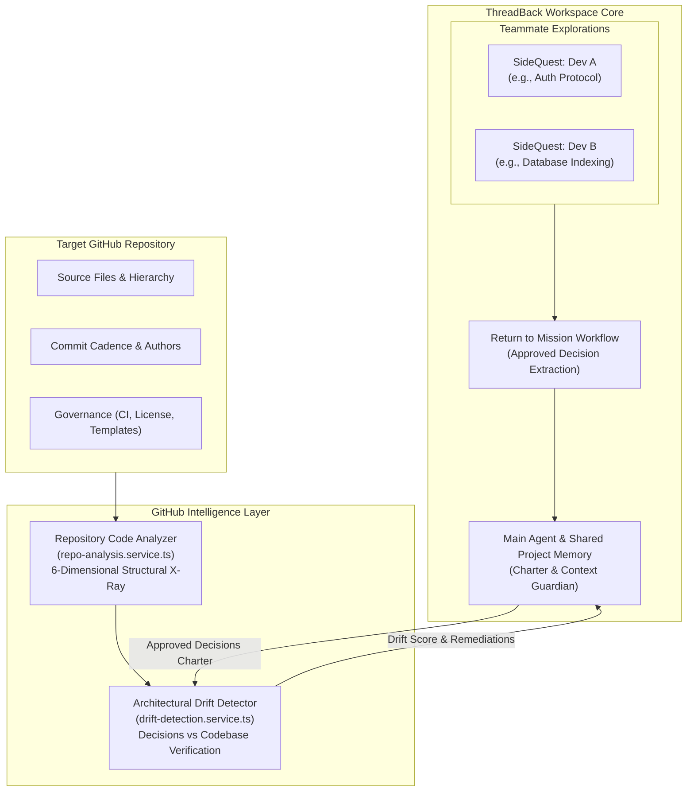
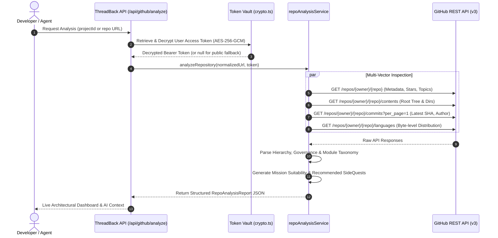

# ThreadBack

> **AI-powered mission workspace with dedicated SideQuests, deep GitHub codebase intelligence, and architectural drift detection.**

[](file:///backend/tests)
[](file:///backend)
[](file:///frontend)
[](file:///backend/data)
[](file:///backend/src/lib/gemma-client.ts)
[](LICENSE)

---

## Overview

Modern software teams using AI face two compounding problems:
1. **Context Pollution**: Exploring technical tangents fills the shared AI context with hundreds of exploratory messages, distracting the AI from the primary mission.
2. **Architectural Drift**: As code is implemented, the repository silently drifts away from the design decisions agreed upon in AI conversations.

**ThreadBack solves both:**
- **Dual-Agent Architecture**: Teammates explore ideas with isolated **SideQuest sub-agents**. When done, a structured **Return to Mission** workflow extracts and incorporates only approved findings into the shared **Main Agent** context.
- **Deep GitHub Codebase Intelligence**: Performs a live, 6-dimensional structural X-ray on any target repository to understand architecture, health, languages, and commit cadence.
- **Living Architectural Drift Detection**: Automatically audits repository code against approved Main AI decisions, scoring drift percentage, detecting violations, and generating code remediations.

---

## Architecture & Data Flow



---

## Detailed Capabilities (One by One)

### 1. Project Setup & GitHub Repository Association

Every workspace begins clean with strict account and team isolation:
- **3-Step Project Setup**: **Project Details** → **Invite Teammates** → **Connect GitHub Repository**.
- **Deterministic Repository Binding**: Validates repository formats (`https://github.com/owner/repo` or `owner/repo`), normalizes URLs, and persists them authoritatively in SQLite (`projects.github_repo`).
- **AES-256-GCM Token Vaulting**: Connects GitHub via OAuth or Personal Access Tokens, encrypting secrets at rest in `backend/src/utils/crypto.ts`.
- **Project Switching Isolation**: Switching projects or accounts instantly reloads the respective repository associations and purges unrelated cache.

---

### 2. Deep GitHub Repository Analysis & Codebase Intelligence

The **Repository Code Analyzer** (`backend/src/services/repo-analysis.service.ts`) acts as an automated, non-invasive **"Live X-Ray"** on any target GitHub repository before or during mission execution.

Instead of treating code as unparsed text, ThreadBack analyzes the physical repository structure, developer cadence, and engineering governance.

```
POST /api/github/analyze
{
  "projectId": "proj-123",
  "repo": "https://github.com/owner/repository"
}
```

#### How We Analyze (The Inspection Pipeline)



1. **Repository Parsing & Normalization**: Accepts full URLs (`https://github.com/owner/repo`) or shorthand (`owner/repo`), strips trailing `.git` extensions and whitespace, and extracts validated `owner` and `repo` segments. If omitted, it automatically queries the active project's bound `projects.github_repo`.
2. **Encrypted Token Injection**: Decrypts the user's vaulted GitHub token with AES-256-GCM and injects `Authorization: Bearer <token>` headers, raising GitHub's rate limit from 60 requests/hr to **5,000 requests/hr**.
3. **Concurrent Multi-Vector Fetching**: Issues parallel requests across GitHub's REST endpoints (repository metadata, contents, commit history, and language metrics).
4. **Structural & Governance Synthesis**: Scans directory assets for institutional standards (`README.md`, `LICENSE`, `CONTRIBUTING.md`, `.github/workflows`), calculates language percentages, and maps topic categories.
5. **AI Suitability & Tangent Formulation**: Formulates mission suitability, auto-recommends high-impact SideQuests, and identifies potential drift risks.
6. **Resilience & Rate-Limit Handling**: If unauthenticated calls hit rate limits (HTTP 403/429), high-traffic educational repositories (such as `codecrafters-io/build-your-own-x`) use an authoritative curated fallback report, ensuring zero workflow interruptions.

---

#### What Exactly Are We Analyzing? (The 6 Technical Dimensions)

| Dimension | What Is Inspected | Why It Matters & What It Reveals |
| :--- | :--- | :--- |
| **1. Metadata & Community Footprint** | Stars, forks, watchers, default branch (`main` vs `master`), visibility, and repository topics. | Proves repository legitimacy, active community adoption, default branch targeting, and broad technical scope. |
| **2. File Tree Topology & Root Assets** | Top-level files and directories (differentiating `[DIR]` from files), root configs, and subfolder layout. | Uncovers codebase structure (monorepo vs single service), locates entrypoints (`src/`, `backend/`, `frontend/`), and flags unexpected asset clutter. |
| **3. Commit Stream & Activity Cadence** | Latest commit SHA, author name/login, commit timestamp, and PR merge messages. | Determines whether the codebase is actively maintained or abandoned, reveals the latest code state, and establishes a baseline SHA for drift auditing. |
| **4. Language & Byte Distribution** | Byte-by-byte language composition calculated via GitHub Linguist. | Reveals the true language makeup (e.g., 65% Rust, 30% TypeScript, 5% Shell) instead of superficial descriptions, and guards against unwanted binary blobs. |
| **5. README & Module Taxonomy** | Root README presence, topic taxonomy, and technical sub-system categorization. | Automatically categorizes the project into core domains (e.g., *Database Engines*, *Container Runtimes*, *Compilers/Parsers*, *Network Protocols*) so AI agents have an instant domain taxonomy. |
| **6. Governance Health & Engineering Rigor** | Verifies existence of `LICENSE`, `CONTRIBUTING.md`, `ISSUE_TEMPLATE.md`, and `.github/workflows/*.yml`. | Audits legal safety (permissive OSS licensing), standardized collaboration guides, bug reporting templates, and automated CI/CD pipelines. |

---

#### ThreadBack Engineering Insights (Actionable AI Layer)

The analyzer synthesizes the raw inspection data into three actionable outputs for the engineering team:
1. **Suitability for Missions**: An objective evaluation of how ready the codebase is for AI-assisted engineering and autonomous agent tasks.
2. **Recommended SideQuests**: Pre-formulated technical investigations that teammates can branch into with a single click (e.g., *"Audit SQLite B-Tree indexing performance"*, *"Investigate container namespace isolation"*).
3. **Architectural Drift Risks**: Explicit flags warning of unpinned dependencies, missing lockfiles, decaying external references, or multi-language version drift.

#### Example Analysis Report JSON

```json
{
  "repository": {
    "name": "build-your-own-x",
    "fullName": "codecrafters-io/build-your-own-x",
    "url": "https://github.com/codecrafters-io/build-your-own-x",
    "stars": 555571,
    "defaultBranch": "master",
    "language": "Markdown",
    "topics": ["systems-programming", "tutorials", "learn-to-code"]
  },
  "latestCommit": {
    "sha": "aa17439b62f384511a5561ce308e9598b94d8989",
    "author": "Maintainer",
    "message": "Merge pull request #1844: fix anchor references"
  },
  "fileSummary": {
    "topLevelCount": 4,
    "items": ["[DIR] .github", "ISSUE_TEMPLATE.md", "README.md", "LICENSE"],
    "languages": { "Markdown": 47830 }
  },
  "keyCategoriesOrModules": ["Database", "Docker", "Git", "Operating System", "Network Stack"],
  "codeQualityAndPractices": {
    "hasDocumentation": true,
    "hasContributionGuide": true,
    "hasIssueTemplate": true,
    "hasRootLicense": true,
    "hasCIWorkflow": true,
    "observations": ["Verified architectural README present at repository root."]
  },
  "threadBackEngineeringInsights": {
    "suitabilityForMissions": "Exceptionally well-suited for ThreadBack Mission and SideQuest workflows.",
    "recommendedSideQuests": [
      "Audit codebase structure and modularity",
      "Evaluate test coverage and CI configuration",
      "Map key dependencies and package architecture"
    ],
    "driftRisks": ["Dependencies may require pinned lockfiles before containerized execution."]
  },
  "rateLimitStatus": "live",
  "analyzedAt": "2026-10-23T17:15:00.000Z"
}
```

---

### 3. Architectural Drift Detection (Code vs Main AI Decisions)

A central problem in collaborative software development: **Does the physical code match what the team agreed upon in the AI chat?**

ThreadBack's **Drift Detection Engine** (`backend/src/services/drift-detection.service.ts`) directly evaluates repository code against live **Main AI Decisions**:

```
POST /api/github/drift-analysis
{
  "projectId": "proj-123"
}
```

#### Step-by-Step Drift Analysis Engine:
1. **Dynamic Context Extraction**: Queries all approved team decisions (`shared_decisions`) recorded by teammates and active mission objectives for the project.
2. **Charter Synthesis**: Forms the baseline specification from approved architecture decisions, rationales, and constraints.
3. **Repository Verification**: Audits repository artifacts, file tree structure, latest commits, and governance files against each approved decision.
4. **Conflict Classification**:
   - `NO_CONFLICT`: Implementation directly satisfies the decision and verified evidence is cited.
   - `CONFIRMED_CONFLICT`: Codebase contradicts the decision (e.g., missing license, violated architectural standard).
   - `POSSIBLE_CONFLICT`: Partial implementation or potential drift without conclusive proof.
   - `INCOMPLETE_IMPLEMENTATION`: Decision accepted but expected artifacts are missing from repository tree.
5. **Quantitative Scoring & Severity**:
   - Calculates a normalized **Drift Score Percentage** (`0%` = fully aligned, `100%` = critical misalignment).
   - Assigns severity ratings: `NONE`, `LOW`, `MEDIUM`, `HIGH`, `CRITICAL`.
6. **Actionable Remediation**: Every identified conflict includes concrete code-level instructions to resolve the discrepancy.

---

### 4. SideQuest Sub-Agents & Tangent Isolation

Each developer explores technical tangents independently without polluting the shared workspace:
- **Private Exploration**: Dev A investigates database indexing in SQLite, while Dev B explores authentication protocols.
- **Zero Cross-Pollution**: SideQuest conversations maintain isolated conversation histories.
- **Context Economy**: 50 back-and-forth debugging messages remain in the SideQuest, preserving LLM token capacity and cognitive clarity.

---

### 5. Return to Mission Workflow

When an investigation concludes, ThreadBack extracts only what matters:
- **Decision & Memory Synthesis**: Identifies conclusions, architecture decisions, and solutions from the sub-agent conversation.
- **Incorporation Tracking**: Tracks whether each finding is pending, approved, or merged into project memory.
- **Shared Attribution**: Records author identity (`userId`, `userName`), timestamp, and source conversation for every contribution.

---

### 6. The Main Agent: Shared Project Coordinator

The Main Agent is the single source of truth for project-level reasoning:
- **Curated Context**: Operates strictly on approved decisions, mission objectives, and incorporated findings—never raw conversation logs.
- **Cross-Tangent Synthesis**: Connects findings from different teammates (e.g., using Dev A's database schema when assisting Dev B with API routes).
- **Persistent Memory**: Stored in SQLite with WAL mode, ensuring decisions survive browser refreshes and server restarts.

---

### 7. Dual-Agent Comparison

| Capability | SideQuest Sub-Agent | Main Agent |
| :--- | :--- | :--- |
| **Scope** | Single teammate's specific tangent | Shared project & team mission |
| **History** | Isolated, deep exploration thread | Curated, approved project context |
| **Token Usage** | Localized to individual investigation | Guarded; receives bounded summaries |
| **Memory Access** | Private to the active SideQuest | Shared decisions & project memories |
| **GitHub Role** | Investigates specific files / modules | Anchors drift analysis against decisions |
| **Output** | Raw exploratory findings | Synthesized team direction & plans |

---

## Technology Stack

| Component | Technology | Rationale |
| :--- | :--- | :--- |
| **Frontend** | React 19, TypeScript, Vite, Tailwind CSS | High-performance reactive UI with type safety |
| **Canvas** | `@xyflow/react` | Interactive mission and SideQuest node visualization |
| **State Management** | Zustand | Unified store with multi-account isolation and 4s sync |
| **Backend** | Node.js, Express 5, TypeScript | Scalable REST API with strict Zod validation schemas |
| **Database** | SQLite with Better-SQLite3 (WAL mode) | Zero-config, zero-network-latency embedded persistence |
| **AI Inference** | `@google/genai` (Gemma 4 / `gemma-4-26b-a4b-it`) | Fast, context-guarded LLM inference via Gemini API |
| **Cryptography** | Node.js native `crypto` | `scryptSync` passwords, HMAC-SHA256 JWTs, AES-256-GCM vault |
| **Testing** | Vitest | 18 automated test suites with 155 unit & integration tests |

---

## Quickstart & Commands

### Prerequisites
- Node.js 18+
- npm 9+

### 1. Start Both Services
Run backend (`http://localhost:4000`) and frontend (`http://localhost:5173`) concurrently:
```bash
npm run dev
```

### 2. Typecheck & Build
```bash
# Typecheck both frontend and backend
npm run typecheck

# Build both applications for production
npm run build
```

### 3. Run Automated Tests
Execute the full Vitest suite (18 suites, 155 tests covering auth, teams, projects, memory, GitHub analysis, and drift detection):
```bash
npm test
```

### 4. Running Backend or Frontend Individually
```bash
# Backend only
npm --prefix backend run dev
npm --prefix backend test

# Frontend only
npm --prefix frontend run dev
npm --prefix frontend run build
```

---

## API Reference (GitHub & Codebase Intelligence)

| Endpoint | Method | Auth | Description |
| :--- | :--- | :--- | :--- |
| `/api/github/connect` | `POST` | Required | Connect GitHub token, encrypt with AES-256-GCM |
| `/api/github/status` | `GET` | Required | Check GitHub connection and token validity |
| `/api/github/repos` | `GET` | Required | List user's accessible GitHub repositories |
| `/api/github/analyze` | `POST/GET` | Optional | Run 6-dimensional structural analysis on repo |
| `/api/github/drift-analysis` | `POST/GET` | Optional | Compare repository code against Main AI decisions |
| `/api/github/feedback` | `POST` | Optional | Submit evaluation (1–5 stars) on analysis report |
| `/api/github/feedback` | `GET` | Optional | Retrieve all feedback for a repository |
| `/api/github/simulate-revocation` | `POST` | Required | Test error recovery when token is revoked |

---

## Repository Map

```
ThreadBack/
├── docs/                          # Architecture, workflows, feature status
│   ├── ARCHITECTURE.md            # Data flow, schema, auth, memory model
│   ├── FEATURE_STATUS.md          # Implementation tracker and verification status
│   └── WORKFLOWS.md               # User & team lifecycle walkthroughs
├── backend/
│   ├── src/
│   │   ├── controllers/           # github, ai, mission, project, team, auth controllers
│   │   ├── db/
│   │   │   ├── schema.ts          # Database schema & migrations
│   │   │   └── repositories/      # github, decision, memory, mission, project, user repos
│   │   ├── lib/gemma-client.ts    # Google GenAI Gemma client
│   │   ├── routes/                # github, ai, mission, project, team, auth routes
│   │   ├── services/
│   │   │   ├── repo-analysis.service.ts   # 6-dimensional codebase structural analyzer
│   │   │   ├── drift-detection.service.ts # Main AI decisions vs codebase drift evaluator
│   │   │   ├── github.service.ts          # GitHub REST API client
│   │   │   └── main-ai.service.ts         # Main Agent context synthesizer
│   │   └── utils/crypto.ts        # AES-256-GCM token encryption & HMAC
│   └── tests/                     # 18 Vitest suites (155 automated tests)
└── frontend/
    └── src/
        ├── api/client.ts          # Typed API client with Bearer auth injection
        ├── components/            # AuthModal, ProjectsModal, DecisionsModal, SideChatDrawer
        ├── store/canvasStore.ts   # Zustand state management with 4s sync
        └── types/index.ts         # TypeScript interfaces
```

---

## License

This project is licensed under the [MIT License](LICENSE).