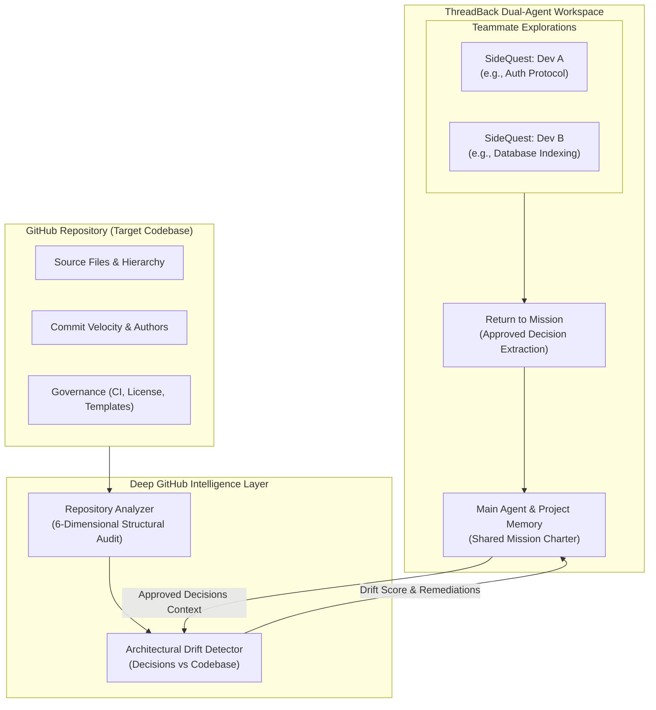

# ThreadBack

> **AI-powered mission workspace with dedicated SideQuests, deep GitHub codebase intelligence, and architectural drift detection.**

[](file:///backend/tests)
[](file:///backend)
[](file:///frontend)
[](file:///backend/data)
[](file:///backend/src/lib/gemma-client.ts)
[](LICENSE)

---

## Overview

Modern software teams using AI face two compounding problems:
1. **Context Pollution**: Exploring technical tangents fills the shared AI context with hundreds of exploratory messages, distracting the AI from the primary mission.
2. **Architectural Drift**: As code is implemented, the repository silently drifts away from the design decisions agreed upon in AI conversations.

**ThreadBack solves both:**
- **Dual-Agent Architecture**: Teammates explore ideas with isolated **SideQuest sub-agents**. When done, a structured **Return to Mission** workflow extracts and incorporates only approved findings into the shared **Main Agent** context.
- **Deep GitHub Codebase Intelligence**: Analyzes connected repositories across structural, linguistic, governance, and quality dimensions.
- **Living Architectural Drift Detection**: Automatically audits repository code against approved Main AI decisions, scoring drift percentage, detecting violations, and generating code remediations.

---

## Capabilities & Architecture (One by One)



---

### 1. Project Setup & GitHub Repository Association

Every workspace begins clean with strict account and team isolation:
- **3-Step Project Initialization**: **Project Details** → **Invite Teammates** → **Connect GitHub Repository**.
- **Deterministic Repository Binding**: Validates repository formats (`https://github.com/owner/repo` or `owner/repo`), sanitizes URLs, and persists them authoritatively in SQLite (`projects.github_repo`).
- **Token Vaulting**: Connects GitHub via OAuth or Personal Access Tokens, encrypting secrets at rest with **AES-256-GCM** in `backend/src/utils/crypto.ts`.
- **Rate Limit Resilience**: Uses authenticated requests (5,000 req/hr) when connected, with graceful fallback to cached architectural profiles (such as curated systems profiles) when rate limits are approached.

---

### 2. Deep GitHub Repository Analysis & Codebase Intelligence

ThreadBack does not treat repositories as static text blobs. It performs an in-depth, multi-dimensional architectural analysis via `repoAnalysisService`:

```
POST /api/github/analyze
{
  "projectId": "proj-123",
  "repo": "https://github.com/owner/repository"
}
```

The analysis produces an authoritative structural report covering:

#### A. Repository Identity & Commit Velocity
- Tracks repository metadata (stars, forks, watchers, topics, default branch).
- Inspects the latest commit: SHA, commit message, and author identity to gauge repository freshness and commit cadence.

#### B. File Tree & Hierarchy Topography
- Parses the top-level repository tree (`/contents`), enumerating root assets, entrypoints, and subdirectory topology.
- Detects the presence of key architectural directories (e.g., `src/`, `backend/`, `frontend/`, `.github/`).

#### C. Language Composition & Byte Distribution
- Calculates exact byte-level language distributions via GitHub's Language API.
- Identifies primary systems languages (C, C++, Rust, Go, TypeScript, Python) and multi-stack footprints.

#### D. Architectural Taxonomy & Subsystem Categorization
- Synthesizes topic tags, directory layouts, and language fingerprints into high-level computational domains (e.g., *Database Engines*, *Container Runtimes*, *Compilers/Parsers*, *Networking Protocols*).

#### E. Code Quality, Governance & CI Audit
Evaluates institutional engineering standards with boolean flags and qualitative observations:
- `hasDocumentation`: Verified presence of architectural root `README.md`.
- `hasContributionGuide`: Detection of `CONTRIBUTING.md` standards.
- `hasIssueTemplate`: Detection of `ISSUE_TEMPLATE.md` or `.github/` templates.
- `hasRootLicense`: Verification of root open-source license (`LICENSE`, `LICENSE.md`, `COPYING`).
- `hasCIWorkflow`: Verification of automated GitHub Actions pipelines (`.github/workflows/*.yml`).

#### F. ThreadBack Engineering Insights & SideQuest Generation
- **Suitability for Missions**: Assesses how well the codebase fits autonomous agent missions.
- **Recommended SideQuests**: Auto-generates high-value tangents for developers to investigate (e.g., *"Audit indexing performance"*, *"Evaluate CI workflow gaps"*).
- **Drift Risks**: Highlights architectural pitfalls, unpinned dependencies, or version discrepancies.

#### G. Feedback & Institutional Rating
- Teammates can rate analysis reports from 1 to 5 stars with qualitative feedback (`POST /api/github/feedback`), persisting institutional ratings in SQLite.

---

### 3. Architectural Drift Detection (Code vs Main AI Decisions)

A central problem in collaborative software development: **Does the actual code match what the team decided in the AI chat?**

ThreadBack integrates **Main AI Decisions** directly into automated drift analysis:

```
POST /api/github/drift-analysis
{
  "projectId": "proj-123"
}
```

#### Step-by-Step Drift Analysis Engine:
1. **Dynamic Context Extraction**: Resolves all approved decisions (`shared_decisions`) recorded by teammates and active mission objectives for the project.
2. **Charter Synthesis**: Forms the baseline specification from approved architecture decisions, rationales, and constraints.
3. **Repository Verification**: Compares the physical repository artifacts, tree structure, latest commits, and governance files against each approved decision.
4. **Conflict Classification**:
   - `NO_CONFLICT`: Implementation directly satisfies the decision and verified evidence is cited.
   - `CONFIRMED_CONFLICT`: Codebase contradicts the decision (e.g., missing license, violated architectural standard).
   - `POSSIBLE_CONFLICT`: Partial implementation or potential drift without conclusive proof.
   - `INCOMPLETE_IMPLEMENTATION`: Decision accepted but expected artifacts are missing from repository tree.
5. **Quantitative Scoring & Severity**:
   - Calculates a normalized **Drift Score Percentage** (`0%` = fully aligned, `100%` = critical misalignment).
   - Assigns severity ratings: `NONE`, `LOW`, `MEDIUM`, `HIGH`, `CRITICAL`.
6. **Actionable Remediation**: Every identified conflict includes concrete code-level instructions to resolve the discrepancy.

---

### 4. SideQuest Sub-Agents & Tangent Isolation

Each developer explores technical tangents independently without polluting the shared workspace:
- **Private Exploration**: Dev A investigates database indexing in SQLite, while Dev B explores authentication protocols.
- **Zero Cross-Pollution**: SideQuest conversations maintain isolated conversation histories.
- **Context Economy**: 50 back-and-forth debugging messages remain in the SideQuest, preserving LLM token capacity and cognitive clarity.

---

### 5. Return to Mission Workflow

When an investigation concludes, ThreadBack extracts only what matters:
- **Decision & Memory Synthesis**: Identifies conclusions, architecture decisions, and solutions from the sub-agent conversation.
- **Incorporation Tracking**: Tracks whether each finding is pending, approved, or merged into project memory.
- **Shared Attribution**: Records author identity (`userId`, `userName`), timestamp, and source conversation for every contribution.

---

### 6. The Main Agent: Shared Project Coordinator

The Main Agent is the single source of truth for project-level reasoning:
- **Curated Context**: Operates strictly on approved decisions, mission objectives, and incorporated findings—never raw conversation logs.
- **Cross-Tangent Synthesis**: Connects findings from different teammates (e.g., using Dev A's database schema when assisting Dev B with API routes).
- **Persistent Memory**: Stored in SQLite with WAL mode, ensuring decisions survive browser refreshes and server restarts.

---

### 7. Dual-Agent Comparison

| Capability | SideQuest Sub-Agent | Main Agent |
| :--- | :--- | :--- |
| **Scope** | Single teammate's specific tangent | Shared project & team mission |
| **History** | Isolated, deep exploration thread | Curated, approved project context |
| **Token Usage** | Localized to individual investigation | Guarded; receives bounded summaries |
| **Memory Access** | Private to the active SideQuest | Shared decisions & project memories |
| **GitHub Role** | Investigates specific files / modules | Anchors drift analysis against decisions |
| **Output** | Raw exploratory findings | Synthesized team direction & plans |

---

## Technology Stack

| Component | Technology | Rationale |
| :--- | :--- | :--- |
| **Frontend** | React 19, TypeScript, Vite, Tailwind CSS | High-performance reactive UI with type safety |
| **Canvas** | `@xyflow/react` | Interactive mission and SideQuest node visualization |
| **State Management** | Zustand | Unified store with multi-account isolation and 4s sync |
| **Backend** | Node.js, Express 5, TypeScript | Scalable REST API with strict Zod validation schemas |
| **Database** | SQLite with Better-SQLite3 (WAL mode) | Zero-config, zero-network-latency embedded persistence |
| **AI Inference** | `@google/genai` (Gemma 4 / `gemma-4-26b-a4b-it`) | Fast, context-guarded LLM inference via Gemini API |
| **Cryptography** | Node.js native `crypto` | `scryptSync` passwords, HMAC-SHA256 JWTs, AES-256-GCM vault |
| **Testing** | Vitest | 18 automated test suites with 155 unit & integration tests |

---

## Quickstart & Commands

### Prerequisites
- Node.js 18+
- npm 9+

### 1. Start Both Services
Run backend (`http://localhost:4000`) and frontend (`http://localhost:5173`) concurrently:
```bash
npm run dev
```

### 2. Typecheck & Build
```bash
# Typecheck both frontend and backend
npm run typecheck

# Build both applications for production
npm run build
```

### 3. Run Automated Tests
Execute the full Vitest suite (18 suites, 155 tests covering auth, teams, projects, memory, GitHub analysis, and drift detection):
```bash
npm test
```

### 4. Running Backend or Frontend Individually
```bash
# Backend only
npm --prefix backend run dev
npm --prefix backend test

# Frontend only
npm --prefix frontend run dev
npm --prefix frontend run build
```

---

## API Reference (GitHub & Codebase Intelligence)

| Endpoint | Method | Auth | Description |
| :--- | :--- | :--- | :--- |
| `/api/github/connect` | `POST` | Required | Connect GitHub token, encrypt with AES-256-GCM |
| `/api/github/status` | `GET` | Required | Check GitHub connection and token validity |
| `/api/github/repos` | `GET` | Required | List user's accessible GitHub repositories |
| `/api/github/analyze` | `POST/GET` | Optional | Run 6-dimensional structural analysis on repo |
| `/api/github/drift-analysis` | `POST/GET` | Optional | Compare repository code against Main AI decisions |
| `/api/github/feedback` | `POST` | Optional | Submit evaluation (1–5 stars) on analysis report |
| `/api/github/feedback` | `GET` | Optional | Retrieve all feedback for a repository |
| `/api/github/simulate-revocation` | `POST` | Required | Test error recovery when token is revoked |

---

## Repository Map

```
ThreadBack/
├── docs/                          # Architecture, workflows, feature status
│   ├── ARCHITECTURE.md            # Data flow, schema, auth, memory model
│   ├── FEATURE_STATUS.md          # Implementation tracker and verification status
│   └── WORKFLOWS.md               # User & team lifecycle walkthroughs
├── backend/
│   ├── src/
│   │   ├── controllers/           # github, ai, mission, project, team, auth controllers
│   │   ├── db/
│   │   │   ├── schema.ts          # Database schema & migrations
│   │   │   └── repositories/      # github, decision, memory, mission, project, user repos
│   │   ├── lib/gemma-client.ts    # Google GenAI Gemma client
│   │   ├── routes/                # github, ai, mission, project, team, auth routes
│   │   ├── services/
│   │   │   ├── repo-analysis.service.ts   # 6-dimensional codebase structural analyzer
│   │   │   ├── drift-detection.service.ts # Main AI decisions vs codebase drift evaluator
│   │   │   ├── github.service.ts          # GitHub REST API client
│   │   │   └── main-ai.service.ts         # Main Agent context synthesizer
│   │   └── utils/crypto.ts        # AES-256-GCM token encryption & HMAC
│   └── tests/                     # 18 Vitest suites (155 automated tests)
└── frontend/
    └── src/
        ├── api/client.ts          # Typed API client with Bearer auth injection
        ├── components/            # AuthModal, ProjectsModal, DecisionsModal, SideChatDrawer
        ├── store/canvasStore.ts   # Zustand state management with 4s sync
        └── types/index.ts         # TypeScript interfaces
```

---

## License

This project is licensed under the [MIT License](LICENSE).